**English** | [简体中文](./README.md)

<picture>
  <source media="(max-width: 640px) and (prefers-color-scheme: dark)" srcset="assets/presentation/hero-mobile-dark.svg">
  <source media="(max-width: 640px)" srcset="assets/presentation/hero-mobile-light.svg">
  <source media="(prefers-color-scheme: dark)" srcset="assets/presentation/hero-dark.svg">
  
</picture>

<div align="center">
  
</div>

**Every time work starts, Claude Code re-walks the approach the last session already falsified. deadend-ledger records failed attempts as tombstones with failing-test evidence and injects them when similar work starts, so the coding agent sees which paths lead nowhere before it takes a step.**

[](https://github.com/SuperMarioYL/deadend-ledger/actions/workflows/ci.yml)
[](https://github.com/SuperMarioYL/deadend-ledger/releases)
[](https://go.dev)
[](https://pkg.go.dev/github.com/SuperMarioYL/deadend-ledger)
[](LICENSE)

`v0.1.0` · [Demo record](docs/demo-results.json) · [Ten-minute quickstart](#quickstart)

##  Why

Anyone running repeated coding-agent sessions on one repository has watched the same scene: the previous session falsified an approach, and this session proposes it again as a fresh idea — burning the same tokens, the same test runs, and the same trust. Prose session memory can **describe** the failure — a lessons-learned paragraph, a gotcha — but it never **excludes** the option at planning time: to the model, the falsified approach and the untried one look equally viable.

deadend-ledger adds the missing record type: the **tombstone**. One tombstone records a falsified approach, its scope (files, symbols, packages), machine-checkable evidence (a failing test, an error span or a build log), and an optional revive condition. At session start, a hook runs `deadend inject`, which renders matching tombstones into a fixed block at the top of planning context — the first thing the agent reads is "this path is dead unless the revive condition holds".

The ledger holds negative results only: no facts, no preferences, no prose memory. That is the division of labor between this tool and general agent memory.

## Architecture

<picture>
  <source media="(max-width: 640px) and (prefers-color-scheme: dark)" srcset="assets/presentation/architecture-mobile-dark.svg">
  <source media="(max-width: 640px)" srcset="assets/presentation/architecture-mobile-light.svg">
  <source media="(prefers-color-scheme: dark)" srcset="assets/presentation/architecture-dark.svg">
  
</picture>

One binary, one file, zero daemons. The session path runs on every prompt with a five-second budget; the record path writes only when the developer runs `record`. The ledger is append-only JSONL — one tombstone per line, small enough to commit — so the failure history follows the repository, not one person's memory.

Code entry points: [internal/ledger](internal/ledger/tombstone.go) · [internal/match](internal/match/similarity.go) · [internal/inject](internal/inject/render.go) · [internal/hooks](internal/hooks/claude.go) · [cmd](cmd/root.go)

Matching is deterministic: after normalization (lowercase, camelCase and acronym splits, file-suffix trims), `deadend inject` scores the length-weighted coverage of each tombstone's scope tokens against the task context, with a constant threshold of 0.35. No embeddings, no network, no model call — the cost is that heavy wording drift causes misses. That is a deliberate trade: an instant offline miss instead of a model call at every session start. Write scope keys that resist drift: paths, symbols, package names.

## Install

Requires Go 1.24+.

```bash
go install github.com/SuperMarioYL/deadend-ledger@latest
deadend --version
```

Alternatively grab a static binary from the [Releases](https://github.com/SuperMarioYL/deadend-ledger/releases) page, or build from source:

```bash
git clone https://github.com/SuperMarioYL/deadend-ledger.git
cd deadend-ledger && go build .
```

## Quickstart

Every step below is reproducible on the bundled fixture: `examples/fixture-demo.sh` builds the CLI, creates an `authservice` fixture repo where the client-side token-refresh approach already failed, and replays the full record / show / inject path.

**1. Init the repo** — creates `.deadend/ledger.jsonl` and merges the SessionStart and UserPromptSubmit hook lines into `.claude/settings.json` (showing the diff first; existing settings are preserved):

```bash
cd your-repo
deadend init
```

**2. Record a tombstone when the agent hits the dead end** — plain `deadend record` asks interactively: approach, scope (defaulting to the files changed in this repo), the evidence locator, the error excerpt (capped at 400 chars), plus optional expiry and revive condition. Scripted runs pass everything as flags:

```bash
deadend record \
  --approach "use client-side token refresh" \
  --scope internal/auth/token.go,TestTokenRefresh \
  --kind failing_test \
  --locator "go test ./internal/auth -run TestTokenRefresh" \
  --file test-output.txt \
  --revive-when "the auth backend accepts idempotent refresh"
```

**3. Verify injection** — a similar task matches; an unrelated task emits nothing:

```bash
deadend inject --context "the token refresh still loops, try the client-side token refresh again"
# <deadend-ledger active-tombstones> ... </deadend-ledger>

deadend inject --context "fix the flaky retry in the download queue" | wc -c
# 0
```

**4. Commit the failure history** (recommended):

```bash
git add .deadend/ledger.jsonl .claude/settings.json
git commit -m "record dead ends: client-side token refresh"
```

## Recorded demo

<picture>
  <source media="(max-width: 640px) and (prefers-color-scheme: dark)" srcset="assets/presentation/process-mobile-dark.svg">
  <source media="(max-width: 640px)" srcset="assets/presentation/process-mobile-light.svg">
  <source media="(prefers-color-scheme: dark)" srcset="assets/presentation/process-dark.svg">
  
</picture>

The full before/after — the agent re-walking the failed approach with an empty ledger, then printing `skipped: tombstone #3` once the tombstone exists — is in [demo/fixture/before_after.md](demo/fixture/before_after.md). The agent dialogue there is scripted fixture material; every `deadend` command output is real.

Below is a real run ([examples/fixture-demo.sh](examples/fixture-demo.sh); full record in [docs/demo-results.json](docs/demo-results.json)): the matching task hits all three tombstones, sorted by score, with #3 (client-side token refresh) first:

```text
$ deadend inject --context "the token refresh still loops; try the client-side token refresh approach in internal/auth/token.go"
<deadend-ledger active-tombstones>
The following approach(es) already failed in this repo. Do NOT retry them unless the revive condition now holds.

[tombstone #3] use client-side token refresh
  scope: internal/auth/token.go, TestTokenRefresh
  evidence: failing_test | go test ./internal/auth -run TestTokenRefresh (observed 2026-10-15)
  excerpt: --- FAIL: TestTokenRefresh (0.00s) token_test.go:11: refresh loop re-entered: token used to refresh itself, next expiry moved backwards. 2 attempts, 2 failures this session. FAIL FAIL authservice/internal/auth 0.312s FAIL
  do-not-retry unless: the auth backend accepts idempotent refresh (tracked as AUTH-214)
[tombstone #1] cache access tokens on disk at ~/.authcache
  scope: internal/auth/store.go
  evidence: error_span | internal/auth/store.go:88: open ~/.authcache: permission denied (observed 2026-10-16)
  excerpt: open ~/.authcache: permission denied — token cache write fails on locked-down CI runners
[tombstone #2] bump the JWT library to v9 to fix the refresh loop
  scope: go.mod, internal/auth
  evidence: build_log | go build ./... (v9 requires module bump of 3 downstream deps) (observed 2026-10-17)
  excerpt: github.com/golang-jwt/jwt/v9: version 9.0.0 requires go >= 1.25; 3 downstream deps pin go 1.24
</deadend-ledger>

$ deadend inject --context "fix the flaky retry in the download queue" | wc -c
       0
```

Terminal recording (the GIF is rendered by [docs/demo.tape](docs/demo.tape) driving the real binary):

 · [Recording script](docs/demo.tape)

## Commands

| Command | What it does | Status |
| --- | --- | --- |
| `deadend init` | Create the ledger and merge the Claude Code hook lines (diff first) | v0.1 |
| `deadend record` | Record one tombstone; full flag surface, interactive prompts in a terminal | v0.1 |
| `deadend show` | Render every tombstone with its evidence locator | v0.1 |
| `deadend inject` | Read the task context and print the tombstone block on match (hook entry point) | v0.1 |
| `deadend review` | Sweep the ledger by status, age and evidence | Planned (`show` for now) |
| `deadend revive <id>` | Lift a tombstone once its revive condition holds | Planned |

The injected block has a hard cap of 2400 characters: no matter how many tombstones match, injection can never flood planning context; entries that no longer fit are dropped by score, with a `deadend show` hint.

## Ledger format

`.deadend/ledger.jsonl` — one tombstone per line, full schema validation on every append. A real one:

```json
{
  "id": "2a8b91d0",
  "approach": "use client-side token refresh",
  "scope": ["internal/auth/token.go", "TestTokenRefresh"],
  "evidence": {
    "kind": "failing_test",
    "locator": "go test ./internal/auth -run TestTokenRefresh",
    "excerpt": "--- FAIL: TestTokenRefresh (0.00s) ...",
    "observed_at": "2026-10-15"
  },
  "status": "active",
  "created_at": "2026-10-15",
  "revive_when": "the auth backend accepts idempotent refresh (tracked as AUTH-214)"
}
```

Field semantics: `id` is derived from approach + locator, so recording the same failure twice is refused; `scope` is the matching key; `evidence.locator` must be a machine-checkable command or error span; `status` is `active` / `expired` / `revived`; a past-due `expires_at` stops injection (tombstone rot); `revive_when` names the condition under which the path is worth retrying. The JSONL format is agent-agnostic — Claude Code is simply the first session environment wired up.

## How it divides responsibility with prose memory

Session-memory tools compress conversations into searchable prose; deadend-ledger turns falsified approaches into excluded options. The two record types solve two problems:

| | Prose session memory | deadend-ledger tombstones |
| --- | --- | --- |
| Record type | Session summaries, observations, preferences | Negative results only (falsified approaches) |
| Evidence | Descriptive summary | Machine-checkable locator (test command, error span) |
| Injection semantics | "There was an experience here" | "This path is dead unless the revive condition holds" |
| Lifecycle | Rolls with the summary | `expires_at` rot, `revive_when` revival |
| Matching | Semantic retrieval | Deterministic token coverage, constant threshold |

On one repository the two coexist: memory owns what happened, the ledger owns what not to do again.

##  Pricing

v0.1 is an open-source CLI that runs locally; a single-player failure ledger costs nothing to use. The next layer of the problem is the team: **a ledger only one developer can see only fixes one developer's memory** — tombstones rot unreviewed, there is no cross-repo view, and nothing stops another pull request from re-walking a known dead end.

The commercial direction is therefore a **hosted team tier** (to launch after the open-source CLI is validated; nothing server-side ships in this repository's v0.1):

| | Open-source CLI (v0.1) | Hosted team tier (planned) |
| --- | --- | --- |
| Shape | Local binary + in-repo JSONL | Hosted service |
| Scope | One repo, one developer | Cross-repo tombstone sync |
| Review | `deadend show` | Review / revive queue |
| CI | — | Automatic comments when a PR re-attempts an active tombstone |

Pricing: $19/seat/month, free for up to 3 seats, 2 months free annually; billing through Stripe globally, with self-serve channels for China to follow.

If your team (3–10 people, several shared repos, daily Claude Code) wants the hosted tier, leave your team size and repository count in [Issues](https://github.com/SuperMarioYL/deadend-ledger/issues) and we will set up a 15-minute walkthrough.

## Roadmap

- **v0.1 (shipped)**: tombstone recording, schema validation, append-only ledger, deterministic matching, injection rendering, the Claude Code hook installer.
- **Next**: `review` / `revive` status transitions (expiry sweeps, revive-condition checks) to complete the tombstone lifecycle.
- **Later**: more agent integrations (the ledger format is agent-agnostic — Cursor, Codex and other session environments are welcome), and the hosted team tier (see [Pricing](#pricing)).

## Limitations

- **Deterministic matching misses**: when task wording drifts far from the scope keys, the tombstone does not inject. Deliberate: instant, offline and free beats a model call at every session start. Drift-resistant scope keys (paths, symbols, package names) reduce misses sharply.
- **Matching reads scope only**: the approach wording does not participate in scoring; match quality depends on scope-key quality.
- **Claude Code only**: the hook installer writes Claude Code settings; other integrations are a later version.
- **Review / revive are not implemented yet**: `show` is the current review surface; past-due tombstones already stop injecting by date, but status transitions land with `review` / `revive`.

## License

[MIT](LICENSE)

<p align="center"><sub><a href="./LICENSE">MIT</a> © 2026 SuperMarioYL</sub></p>
